<div align="center">

# 👗 OTBOO | 옷장을 부탁해

### 오늘 뭐 입지?

날씨와 취향에 맞는 나만의 데일리 코디

**개인화 의상 및 아이템 추천 SaaS**

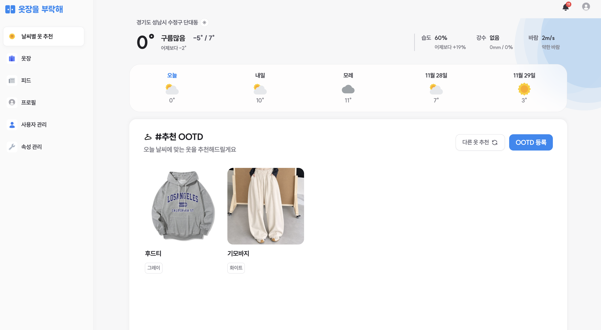

<br>


[](https://app.codecov.io/gh/sb13-team2-advanced/sb13-otboo-team2)
[](https://github.com/sb13-team2-advanced/sb13-otboo-team2/actions/workflows/deploy.yml)

[🌐 서비스 바로가기](https://d32h6socf0ryd3.cloudfront.net)
· [📖 Swagger](https://d32h6socf0ryd3.cloudfront.net/swagger-ui/index.html)
· [📋 Notion](https://internal-squid-ffe.notion.site/2-3ff16900ac5180d79239e4645af5fce3)

</div>

---

## 📌 프로젝트 소개

**옷장을 부탁해(OTBOO)**는 날씨, 사용자 취향 및 보유 의상을
기반으로 개인화된 의상 조합을 추천하는 서비스입니다.

사용자는 자신의 옷장을 관리하고 날씨에 맞는 코디를 추천받으며,
OOTD 피드, 팔로우, 실시간 DM 등을 통해 다른 사용자와
스타일을 공유하고 소통할 수 있습니다.

관리자는 사용자 권한, 계정 상태 및 의상 속성을 관리할 수 있습니다.

| 항목 | 내용 |
| :--- | :--- |
| 개발 기간 | 2026.10.21 ~ 2026.11.30 |
| 개발 인원 | 백엔드 개발자 6명 |
| 교육 과정 | 코드잇 스프린트 Spring 백엔드 13기 |
| 프로젝트 유형 | 고급 팀 프로젝트 |

## 👥 팀원 및 역할

| 이름 | 담당 도메인 |
| :---: | :--- |
| **유하정 (팀장)** | 사용자 관리 · 인증 · 권한 |
| **유승완** | 프로필 관리 · 의상 관리 |
| **최성웅** | 날씨 데이터 관리 · 배치 |
| **함지원** | 의상 추천 |
| **김지원** | OOTD 피드 |
| **백한천** | 팔로우 · DM · 알림 |

## 🛠️ 기술 스택

| 구분 | 기술 |
| :--- | :--- |
| Language | Java 17 |
| Backend | Spring Boot, Spring Data JPA, QueryDSL |
| Security | Spring Security, JWT, OAuth2 |
| Database | PostgreSQL, pgvector, H2 (Test) |
| Cache & Pub/Sub | Redis |
| Migration | Flyway |
| Batch | Spring Batch |
| Real-time | WebSocket, STOMP, SSE |
| Messaging | Apache Kafka, Confluent Cloud |
| External API | OpenWeatherMap, Kakao Local API |
| Infrastructure | AWS ECS, ECR, S3, CloudFront, ALB, Docker |
| Monitoring | Spring Actuator, Prometheus |
| CI/CD | GitHub Actions |
| Test | JUnit 5, Mockito, AssertJ |
| Coverage | JaCoCo, Codecov |
| Documentation | Swagger, Notion |

## ✨ 주요 기능

| 도메인 | 주요 기능 |
| :--- | :--- |
| 사용자 관리 | 회원가입, 로그인, JWT 인증·인가, 소셜 계정 연동, 비밀번호 초기화 |
| 관리자 | 사용자 권한 변경, 계정 잠금, 강제 로그아웃, 의상 속성 관리 |
| 프로필 | 사용자 정보, 위치, 온도 민감도 설정 |
| 의상 관리 | 의상 등록·조회·수정·삭제, 구매 URL 기반 정보 추출 |
| 날씨 | 외부 날씨 API 연동, Spring Batch 기반 데이터 수집 |
| 의상 추천 | 날씨·프로필·보유 의상 기반 개인화 의상 추천 |
| OOTD 피드 | 피드 작성, 좋아요, 댓글 |
| 팔로우 · DM | 팔로우, 실시간 메시지 송수신, 대화 내역 조회 |
| 알림 | SSE 기반 실시간 알림, Kafka 기반 비동기 이벤트 처리 |

## 🎬 서비스 화면 및 시연

<table>
  <tr>
    <th width="50%">날씨 기반 의상 추천</th>
    <th width="50%">나만의 옷장</th>
  </tr>
  <tr>
    <td align="center">
      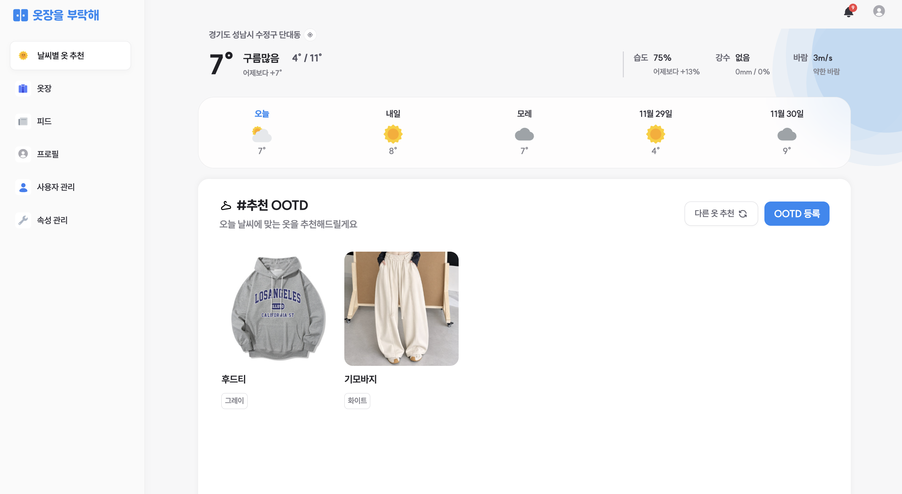
    </td>
    <td align="center">
      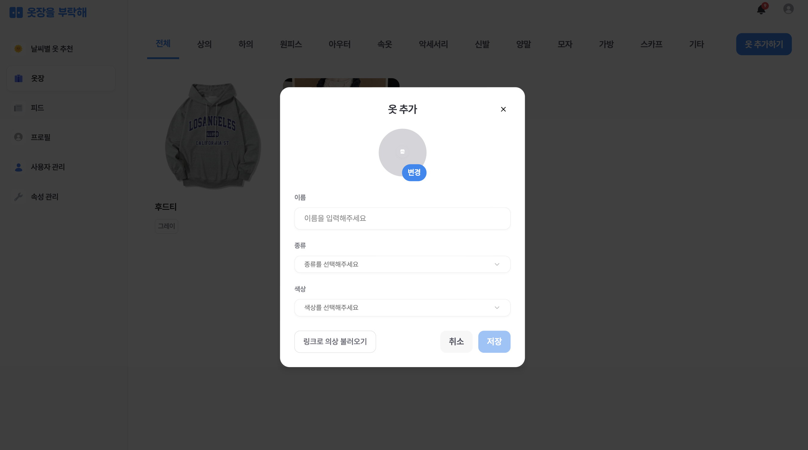
    </td>
  </tr>
  <tr>
    <th>OOTD 피드</th>
    <th>실시간 DM</th>
  </tr>
  <tr>
    <td align="center">
      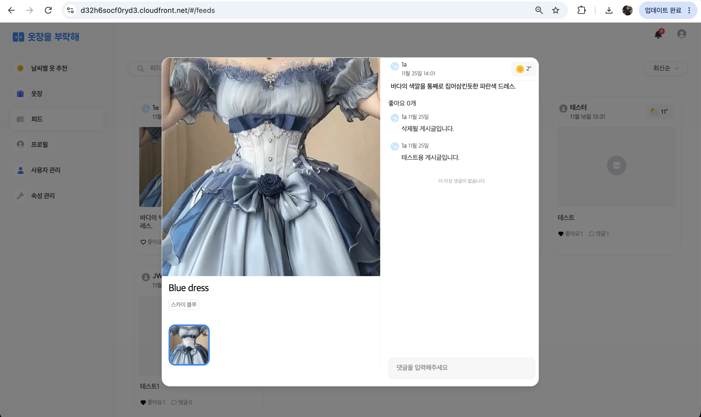
    </td>
    <td align="center">
      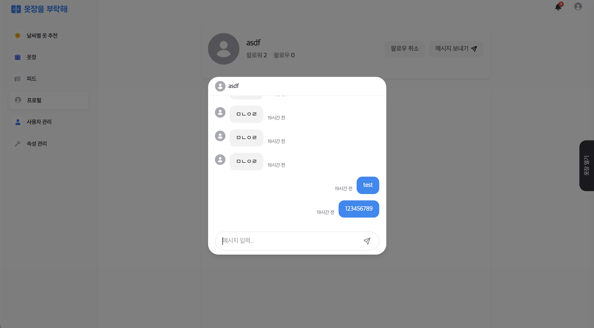
    </td>
  </tr>
  <tr>
    <th>관리자 - 사용자 관리</th>
    <th>관리자 - 의상 속성 관리</th>
  </tr>
  <tr>
    <td align="center">
      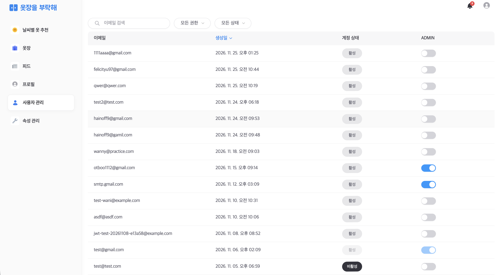
    </td>
    <td align="center">
      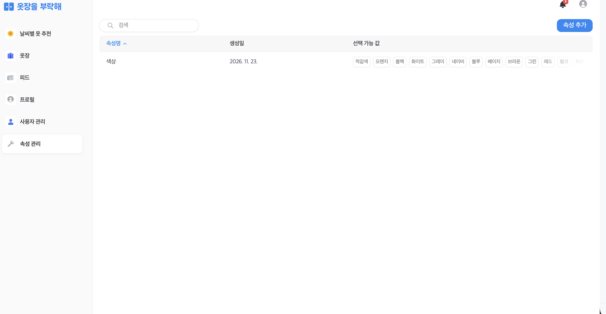
    </td>
  </tr>
</table>

<div align="center">

<h3>🎥 전체 서비스 시연 영상</h3>

<a href="https://drive.google.com/file/d/14YNlb9PBdI0ZjLEO1ccYmFLcr3xtcdWR/view?usp=drive_link">
  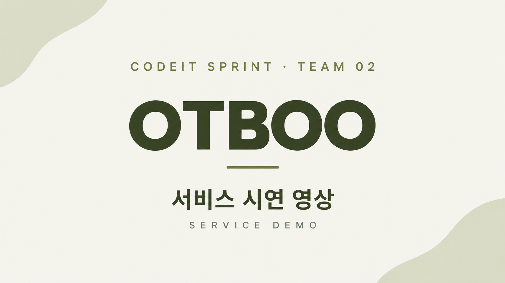
</a>

<p>※ 이미지를 클릭하면 시연 영상 페이지로 이동합니다.</p>

</div>

## 🏗️ 시스템 아키텍처

<div align="center">
  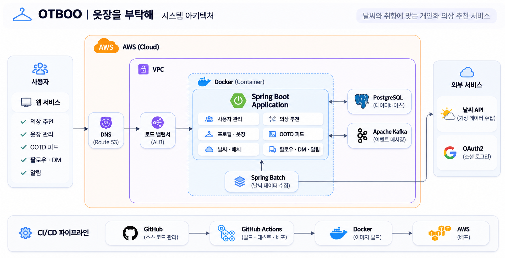
</div>

## 🗂️ ERD

<div align="center">
  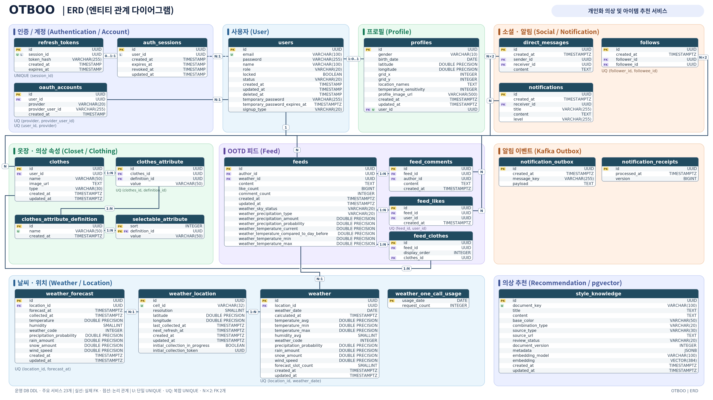
</div>

## ⚙️ 핵심 기술

| 기술 | 적용 내용 |
| :--- | :--- |
| JWT · Spring Security | 인증·인가, 토큰 재발급 및 사용자 세션 관리 |
| OAuth2 | Google · Kakao 소셜 계정 연동 |
| Spring Batch | 날씨 데이터 수집 및 주기적 갱신 |
| Cursor Pagination | 사용자 목록 및 DM 대화 내역 조회 |
| pgvector | 의상 추천 관련 벡터 데이터 관리 |
| Redis | 실시간 이벤트 전달 및 분산 환경 지원 |
| WebSocket · SSE | 실시간 메시지 송수신 및 알림 처리 |
| Kafka · Outbox | 비동기 이벤트 발행, 중복 처리 방지, 재시도 및 DLT |
| Global Exception Handling | Bean Validation, ErrorCode, 커스텀 예외 기반 오류 관리 |

## 🔥 트러블슈팅

| 문제 상황 | 해결 방법 |
| :--- | :--- |
| JWT 재발급 시 프론트엔드 인증 상태 불일치 | 프론트엔드 응답 계약을 분석하여 사용자 정보 응답 구조 개선 |
| 날씨 데이터 최초 수집 시 동시성 문제 | DB 조건부 UPDATE를 활용한 수집 권한 제어 및 대기 처리 |
| 외부 URL 요청 시 SSRF 보안 위험 | 내부 네트워크 접근 제한, 리다이렉트 검증, 타임아웃 및 응답 크기 제한 |
| Kafka 이벤트 중복 처리 | 이벤트 ID 기반 처리 이력 및 DB 제약 조건을 활용한 멱등성 확보 |

## 🧪 테스트 및 CI/CD

### 테스트 전략

- TDD 기반 Red-Green-Refactor 개발
- JUnit 5, Mockito 기반 단위 테스트
- Spring Boot 기반 통합 테스트
- 핵심 비즈니스 로직 및 예외 상황 검증
- Pull Request 생성 시 자동 빌드 및 테스트

### 테스트 커버리지

| 항목 | 내용 |
| :--- | :--- |
| 목표 커버리지 | 80% 이상 |
| 기준 브랜치 | `main` |
| 측정 도구 | JaCoCo |
| 커버리지 관리 | Codecov |
| 갱신 방식 | GitHub Actions 기반 자동 갱신 |

최신 테스트 커버리지는 README 상단의 Codecov 배지를 통해 확인할 수 있습니다.

[📊 상세 테스트 커버리지 확인](https://app.codecov.io/gh/sb13-team2-advanced/sb13-otboo-team2)

### CI/CD 파이프라인

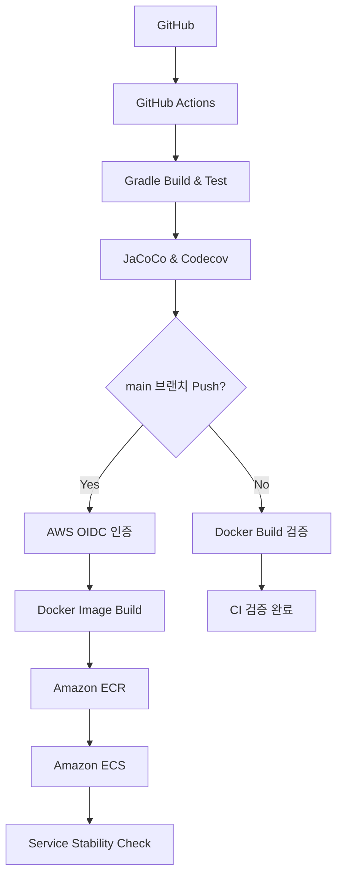

- Pull Request 생성 시 자동 빌드 및 테스트
- JaCoCo 및 Codecov 기반 테스트 커버리지 관리
- AWS OIDC 기반 배포 인증
- Docker 이미지 빌드 및 Amazon ECR 저장
- `main` 브랜치 Push 시 Amazon ECS 자동 배포
- 배포 완료 후 서비스 안정성 및 실행 상태 검증

### Git 브랜치 전략

| 브랜치 | 역할 |
| :--- | :--- |
| `main` | 운영 및 최종 배포 |
| `dev` | 개발 기능 통합 |
| `feat/*` | 기능 개발 |
| `fix/*` | 오류 수정 |
| `refactor/*` | 코드 리팩토링 |
| `docs/*` | 문서 작성 및 수정 |

Pull Request 기반 코드 리뷰와 CI 검증 후
Squash Merge를 진행합니다.

## 💻 프로젝트 실행 방법

### 사전 요구사항

- Java 17
- Docker 및 Docker Compose
- Git

### 1. Repository Clone

```bash
git clone https://github.com/sb13-team2-advanced/sb13-otboo-team2.git
cd sb13-otboo-team2
```

### 2. 환경변수 설정

프로젝트 실행에 필요한 환경변수를 `.env.dev` 파일에 설정합니다.

- PostgreSQL 및 Redis 연결 정보
- JWT Secret
- OpenWeatherMap 및 Kakao API Key
- 이메일 발송 설정
- Google 및 Kakao OAuth2 설정
- Kafka 연동 설정

실제 API Key, 비밀번호 등의 민감 정보는
GitHub에 업로드하지 않습니다.

### 3. Docker Compose 실행

```bash
docker compose --env-file .env.dev up -d
```

PostgreSQL(pgvector 포함) 및 Redis 컨테이너를 실행합니다.

### 4. Build & Run

```bash
./gradlew clean build
./gradlew bootRun
```

### 5. 로컬 서비스 접속

- 서비스: http://localhost:8080
- Swagger: http://localhost:8080/swagger-ui/index.html

※ 로컬 실행 포트 및 활성 프로필에 따라 접속 주소가 달라질 수 있습니다.

## 📚 프로젝트 산출물

| 산출물 | 링크 |
| :--- | :--- |
| 배포 서비스 | [서비스 바로가기](https://d32h6socf0ryd3.cloudfront.net) |
| 프로젝트 협업 문서 | [Notion](https://internal-squid-ffe.notion.site/2-3ff16900ac5180d79239e4645af5fce3) |
| API 명세서 | [Swagger](https://d32h6socf0ryd3.cloudfront.net/swagger-ui/index.html) |
| 테스트 커버리지 | [Codecov](https://app.codecov.io/gh/sb13-team2-advanced/sb13-otboo-team2) |
| CI/CD 실행 결과 | [GitHub Actions](https://github.com/sb13-team2-advanced/sb13-otboo-team2/actions/workflows/deploy.yml) |
| 최종 발표 자료 | [📄 발표 자료 PDF](./docs/final-presentation.pdf) |
| 서비스 시연 영상 | [Google Drive](https://drive.google.com/file/d/14YNlb9PBdI0ZjLEO1ccYmFLcr3xtcdWR/view?usp=drive_link) |

---

<div align="center">

**👗 OTBOO | 옷장을 부탁해**

오늘의 날씨에 어울리는, 나만의 스타일

Codeit Sprint Spring Backend 13기 · Team 2

2026.10.21 ~ 2026.11.30

</div>
